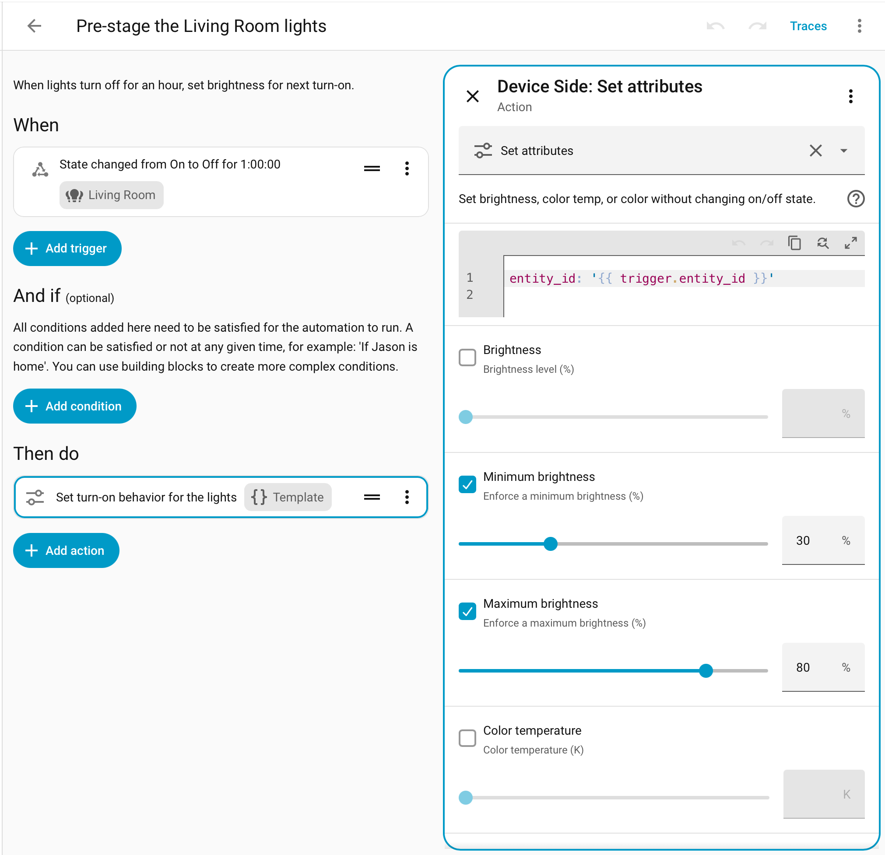

# Set next turn-on brightness

When lights turn off for an hour, set brightness for next turn-on.



To set up this automation:

1. Go to **Settings > Automations**
2. Click **Create automation** and **Create new automation**
3. Open the ⋮ menu and switch view to **Edit in YAML**
4. Copy-paste the YAML below (replacing HA's placeholder YAML)
5. Switch view back to **Edit in visual editor**
6. Select the ["When something changes" entry](set-turn-on-brightness--step-1.png?raw=true) and add your lights.
7. Select the "Set turn-on behavior" entry and choose your settings. Don't touch the Targets section.
8. Click **Save**

```yaml
description: >
  When lights turn off for an hour, set brightness for next turn-on.
triggers:
  - trigger: state
    entity_id: []
    from:
      - "on"
    to:
      - "off"
    for:
      hours: 1
      minutes: 0
      seconds: 0
actions:
  - action: deviceside.set_attributes
    target:
      entity_id: "{{ trigger.entity_id }}"
    data:
      max_brightness: 80
      min_brightness: 30
    alias: Set turn-on behavior for the lights
mode: parallel
max: 10
```

If you add more than 10 lights, increase "max: 10" accordingly.
